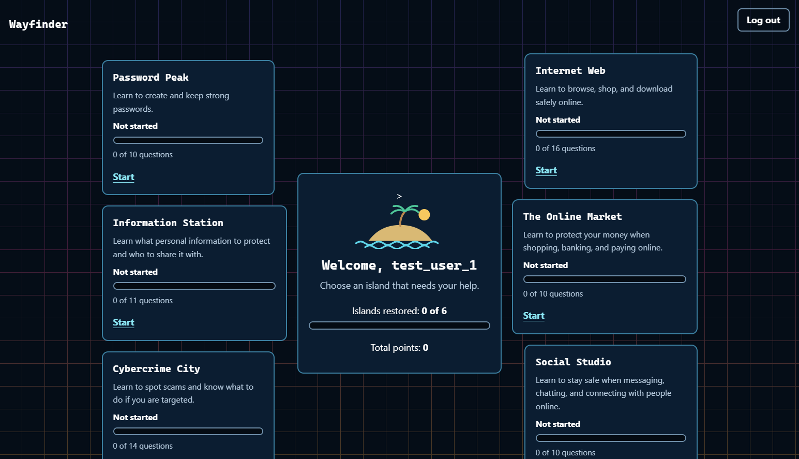
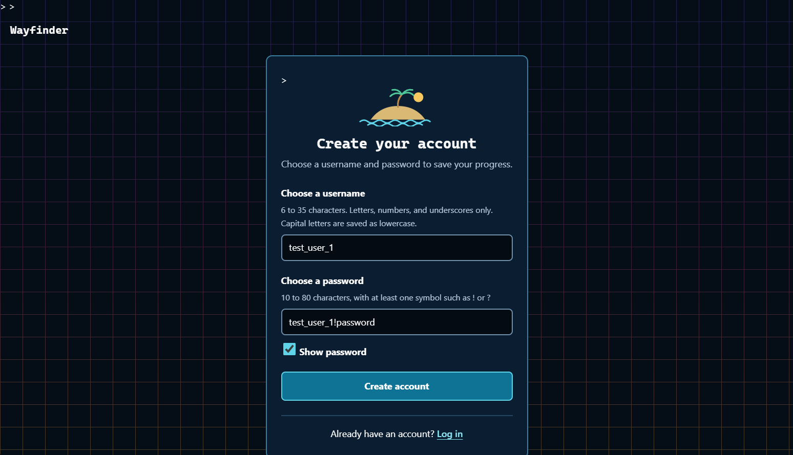
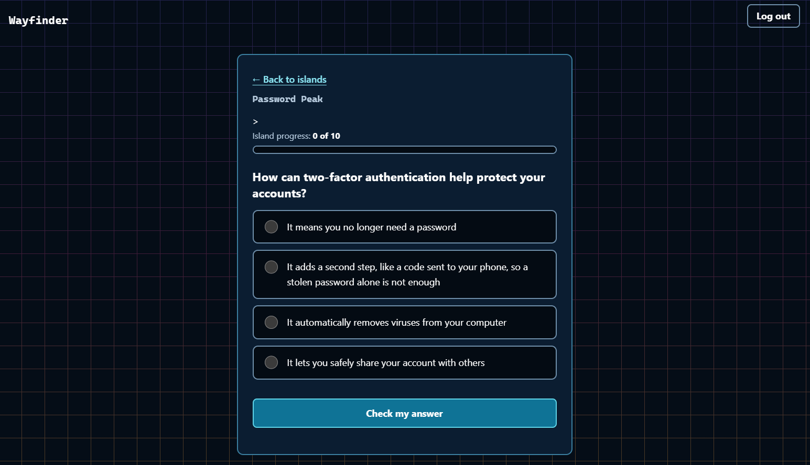
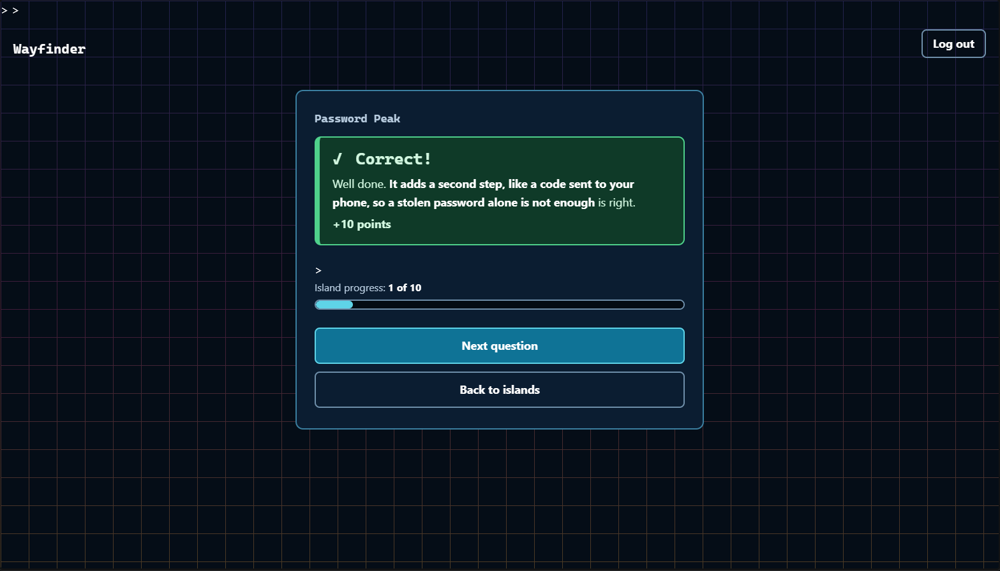
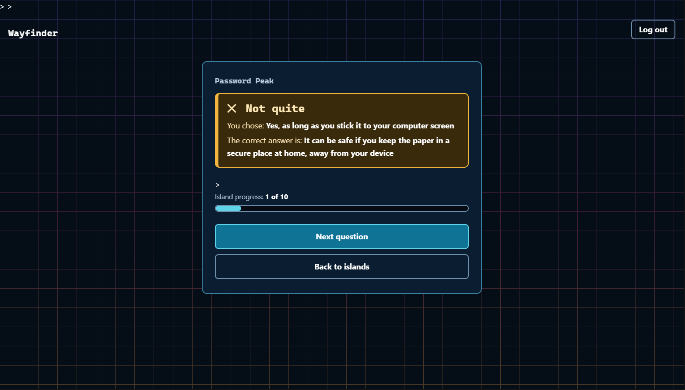

# Wayfinder

## Short Description

Web application intended to help the elderly and new to the internet learn safe internet practices to reduce compromises, hacks, and theft.

## Screenshots of the functional application

The hub page with six islands to choose from

The registration page with valid login info

A question from island 1 (Password Peak)

A correct answer to a question from island 1 (Password Peak)

A wrong answer to a question from island 1 (Password Peak)



## Intended Result/Function

- Users create a secure account for the website
- Users then can answer questions to "help" each island while learning
- Each island is based around a specific topic
- Users gain instant feedback on question results, gaining points,  progress, and knowledge on best practices moving forward.
- Questions can be replayed. Once you’ve answered a question correctly, later correct answers to it earn half points.
- Each island loses 1 question of progress per day until it reaches 0, encouraging practice after completion.

## Resources it's built with

- Python
- HTML
- CSS
- python-dotenv
- Flask
- SQLAlchemy
- SQLite
- Flask-WTF
- Flask-Limiter
- Jinja Templates

## Local run instructions

1. Download or clone the project, and open a terminal in its folder (Python 3 required)
2. Create a virtual environment and install the requirements

```bash
python -m venv .venv
.venv\Scripts\activate # Mac/Linux: source .venv/bin/activate
pip install -r requirements.txt
```

3. Create your .env file (steps below)
Necessary for functionality as well (Holds the key to prevent impersonation/logins to anyone's account)

- Copy the env file

```bash
   # Windows (Command Prompt)
   copy .env.example .env # Mac/Linux: cp .env.example .env

   # Mac/Linux
   cp .env.example .env
```
- Generate a random, secure key
```bash
   python -c "import secrets; print(secrets.token_hex(32))"
```
- Open .env in a text editor and type/paste in the secret key (ensure no spaces between the equals sign and the variable/value as shown below)

```
   SECRET_KEY=paste-your-generated-key-here
```

4. Load the questions: python seed.py

```bash
python seed.py
```

5. Start the app: python app.py

```bash
python app.py
```

6. Open http://127.0.0.1:5000 in your browser


## Use instructions

On the launch page, there is a link to create an account at the bottom of the login form.

Click the create an account link, and make a username and password that fit the criteria listed (username: 6-35 letters, numbers, or underscores. password: 10-80 characters with at least 1 symbol).

After successful account creation, you're redirected to the login page where you can login with the same information put in registration.

Afterwards, you'll be redirected to the home page, click on any island to answer questions and get progress, or logout in the top right.

## Security and accessibility features

- Hashed passwords with Werkzeug
- CSRF Protection (protects against malicious website command execution)
- Rate limits on login attempts and question answer submissions
- Each question can only be scored once, even when submitted twice (double clicking or two tabs)
- Large text for elderly use
- High contrast between text and background for the elderly
- No emails or personal data are collected, only a username, progress, and a hashed password are stored.

## AI USAGE DISCLOSURE

AI Tools used:
1. Claude by Anthropic
2. ChatGPT by OpenAI

Claude explained concepts, suggested the design and security approach, gave example code lines (and a starting seed.py) that I adapted, and reviewed for bugs.

I wrote and assembled the routes, models, and logic in app.py, tested them, and fixed the problems found.

The seed_data.py file was generated by Claude and ChatGPT to fulfill the data structures I had created within app.py, the questions generated by ChatGPT were reviewed, then answers were generated by Claude for each section. Names for each of the islands were personally created.

All questions within the seed_data.py file were then reviewed and kept as accurate, determined by alignment with CISA principles.

Each of the HTML template files were generated by Claude, then reviewed.
The main CSS file for the project was generated by Claude then reviewed.
Design guidance for HTML and CSS layouts and colors were also provided by Claude, then taken into account.

The README.md file was written by me, then reviewed by Claude, with specific feedback that was reviewed then incorporated for better transparency and readability.

Afterwards, each of these files was confirmed and added to the project.

## CISA Sources
https://www.cisa.gov/cybersecurity-awareness-month
https://www.cisa.gov/resources-tools/training/cyb3rsmrt-use-password-manager-create-and-remember-strong-passwords
https://www.cisa.gov/topics/cybersecurity-best-practices
https://consumer.ftc.gov/articles/how-spot-avoid-and-report-tech-support-scams
https://consumer.ftc.gov/articles/how-recognize-avoid-phishing-scams
https://consumer.ftc.gov/consumer-alerts/2025/02/looking-love-watch-out-scammers
https://consumer.ftc.gov/articles/buying-online-marketplace
https://consumer.ftc.gov/articles/what-do-if-you-were-scammed